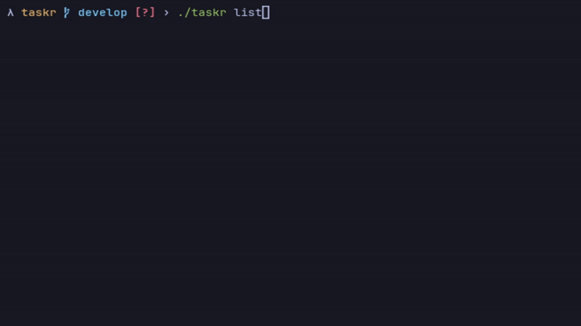

<h1 align="center"> Taskr


[](https://github.com/laporeon/taskr/blob/main/LICENSE)

</h1>

## Table of Contents

- [About](#about)
- [Requirements](#requirements)
- [Getting Started](#getting-started)
  - [Quick Start](#quick-start)
  - [Install as a Local Command](#install-as-a-local-command)
    - [Linux / macOS](#linux--macos)
    - [Windows PowerShell](#windows-powershell)
- [Usage](#usage)
- [Preview](#preview)

## About

Taskr is a Java-based CLI to easily manage your tasks through your terminal.

**Key features:**

- Persists tasks locally in a simple `tasks.txt` file.
- Validates status and priority against defined patterns.
- Full CRUD operations for tasks.
- Generates UUID-based IDs to avoid collisions in the local file.
- Uses 1-based indexing for list and delete commands to improve usability.

## Requirements

- Java 21+
- Make _(optional)_

> [!NOTE]
> - The project ships with the Maven Wrapper, so a global Maven installation is not required.

## Getting Started

The development workflow is powered by the Makefile. Run `make help` to list all available commands.

> [!NOTE]
> `make` is available out of the box on Linux and macOS. On Windows, use [WSL](https://learn.microsoft.com/windows/wsl/).

| Command | Description |
|---|---|
| `make build` | Clean and package the executable JAR (`target/taskr.jar`) |
| `make compile` | Compile the project |
| `make verify` | Run Maven verification |
| `make clean` | Clean Maven build artifacts |
| `make run` | Build and run the application locally |
| `make install` | Build and install the `taskr` command in `~/.local/bin` |
| `make uninstall` | Remove the installed `taskr` command |

### Quick Start

```bash
make run # Build and run the application.
```

**Without Make**

```bash
# Linux / macOS
./mvnw clean package          # Build the JAR.
java -jar target/taskr.jar    # Or use the wrapper script: chmod +x taskr && ./taskr


# Windows PowerShell
.\mvnw.cmd clean package      # Build the JAR.
java -jar target\taskr.jar    # Or use the wrapper script: .\taskr.bat
```

### Install as a Local Command

**Linux / macOS**

```bash
make install # Install the taskr command in ~/.local/bin.
```

> [!NOTE]
> Make sure `~/.local/bin` is in your `PATH` by adding `export PATH="$HOME/.local/bin:$PATH"` to your shell profile (`~/.bashrc` or `~/.zshrc`).

After that, run `taskr` from any directory. To remove it, run `make uninstall`.

**Windows PowerShell**

After building the JAR, add the function below to your PowerShell profile (`notepad $PROFILE`), replacing `C:\full\path\to\taskr` with the absolute path to the project:

```powershell
function taskr {
    java -jar "C:\full\path\to\taskr\target\taskr.jar" @args
}
```

Reload the profile with `. $PROFILE` and run `taskr` from any directory.

> [!NOTE]
> The function is available only in PowerShell, not in Command Prompt.

## Usage

Quick reference. For full details, run `taskr --help`.

```text
Usage: taskr [command] [options]

Commands:
  add <title> [options]         Create a new task.
  list [options]                List all tasks or list tasks by status.
  update <index> [options]      Update task title, status and/or priority.
  delete <index> [options]      Delete a task.

Examples:
  $ taskr add "Clean node_modules"
  $ taskr add "Study Java" -p "high"
  $ taskr list
  $ taskr list -s "todo"
  $ taskr update 2 -t "New Task Title"
  $ taskr update 3 -p "high"
  $ taskr update 4 -s "in-progress"
  $ taskr update 5 -t V"New Task Title" -p "medium" -s "in-progress"
  $ taskr delete 6
```

## Preview



[⬆ Back to the top](#table-of-contents)
