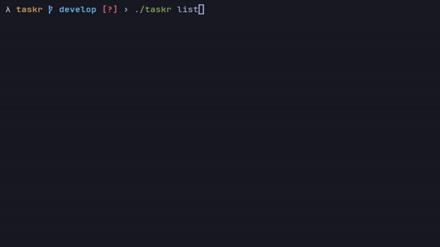

<h1 align="center"> Taskr


[](https://github.com/laporeon/taskr/blob/main/LICENSE)

</h1>

## Table of Contents

- [About](#about)
- [Requirements](#requirements)
- [Getting Started](#getting-started)
  - [Build](#1-build)
  - [Run](#2-run)
  - [Install as a local command](#3-install-as-a-local-command)
      - [Linux / macOS](#linux--macos)
      - [Windows PowerShell](#windows-powershell)
- [Usage](#usage)
- [Preview](#preview)

## About

Taskr is a Java-based CLI to easily manage your tasks through your terminal.

**Key features:**

- Persists tasks locally in a simple `tasks.txt` file.
- Validates status and priority against defined patterns.
- Full CRUD operations for tasks.
- Generates UUID-based IDs to avoid collisions in the local file.
- Uses 1-based indexing for list and delete commands to improve usability.

## Requirements

- Java 21+
- Make _(optional)_

Maven is not required because the project includes the Maven Wrapper:

- `./mvnw` for Linux and macOS
- `mvnw.cmd` for Windows

## Getting Started

The project provides a `Makefile` with commands for building, testing, running, and installing the application.

Run `make help` to list all available targets.

> [!NOTE]
> `make` is available out of the box on Linux and macOS. On Windows, use [WSL](https://learn.microsoft.com/windows/wsl/),
> or run the equivalent commands from the table below (use `mvnw.cmd` instead of `./mvnw`).

| Command | Description | Equivalent without Make |
|---|---|---|
| `make help` | Show all available commands | Check the `Makefile` manually |
| `make build` | Clean and package the executable JAR | Linux/macOS: `./mvnw clean package`<br>Windows: `mvnw.cmd clean package` |
| `make compile` | Compile the project | Linux/macOS: `./mvnw compile`<br>Windows: `mvnw.cmd compile` |
| `make verify` | Run Maven verification | Linux/macOS: `./mvnw verify`<br>Windows: `mvnw.cmd verify` |
| `make clean` | Clean Maven build artifacts | Linux/macOS: `./mvnw clean`<br>Windows: `mvnw.cmd clean` |
| `make run` | Build, and run the application locally | Linux/macOS: `./mvnw clean package && java -jar target/taskr.jar`<br>Windows PowerShell: `.\mvnw.cmd clean package; java -jar target/taskr.jar` |
| `make install` | Build and install the `taskr` command in `~/.local/bin` | Build with `./mvnw clean package`, then create an executable launcher for `target/taskr.jar` |
| `make uninstall` | Remove the installed `taskr` command | Linux/macOS: `rm -f "$HOME/.local/bin/taskr"` |

### 1. Build

Using Make:

```bash
make build
```

Or using the Maven Wrapper directly:

```bash
# Linux / macOS
./mvnw clean package

# Windows
mvnw.cmd clean package
```

The executable JAR will be generated at:

```text
target/taskr.jar
```

### 2. Run

Pick the option that fits your workflow:

**Option 1 - Using Make:**

```bash
# Linux / macOS only
make run
```

**Option 2 — Direct JAR execution**

```bash
# Linux / macOS
java -jar target/taskr.jar

# Windows
java -jar target\taskr.jar
```

**Option 3 — Wrapper script**

```bash
# Linux / macOS (first time only: make it executable)
chmod +x taskr
./taskr

# Windows PowerShell
.\taskr.bat
```

The wrappers run the JAR generated at `target/taskr.jar`. Build the application first with
`make build`, `./mvnw clean package`, or `mvnw.cmd clean package`, depending on your platform.

### 4. Install as a local command

#### Linux / macOS

To run `taskr` from any directory on Linux or macOS:

```bash
make install
```

This creates an executable launcher at:

```text
~/.local/bin/taskr
```

Make sure `~/.local/bin` is included in your `PATH`:

```bash
export PATH="$HOME/.local/bin:$PATH"
```

To persist this configuration, add it to your shell profile:

```bash
echo 'export PATH="$HOME/.local/bin:$PATH"' >> ~/.bashrc
source ~/.bashrc
```

For Zsh:

```bash
echo 'export PATH="$HOME/.local/bin:$PATH"' >> ~/.zshrc
source ~/.zshrc
```

After installation, run the application from anywhere:

```bash
taskr
```

To remove the installed command:

```bash
make uninstall
```

#### Windows PowerShell

Build the application first:

```powershell
.\mvnw.cmd clean package
```

Then add the following function to your PowerShell profile, replacing `C:\full\path\to\taskr` with the absolute path to your project directory.

```powershell 
function taskr {
    java -jar "C:\full\path\to\taskr\target\taskr.jar"
}
```

Save the file, and reload the profile:

```powershell
. $PROFILE
```

After that, run the application from any directory:

```powershell
taskr
```

> [!NOTE]
> The PowerShell function is available only in PowerShell.
> It does not create a command for Command Prompt.

## Usage

Quick reference. For full details, run `taskr --help`.

```text
Usage: taskr [command] [options]

Commands:
  add <title> [options]         Create a new task.
  list [options]                List all tasks or list tasks by status.
  update <index> [options]      Update task title, status and/or priority.
  delete <index> [options]      Delete a task.

Examples:
  $ taskr add "Clean node_modules"
  $ taskr add "Study Java" -p "high"
  $ taskr list
  $ taskr list -s "todo"
  $ taskr update 2 -t "New Task Title"
  $ taskr update 3 -p "high"
  $ taskr update 4 -s "in-progress"
  $ taskr update 5 -t "New Task Title" -p "medium" -s "in-progress"
  $ taskr delete 6
```

## Preview



[⬆ Back to the top](#-taskr)
